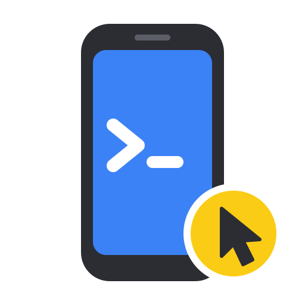

<a name="readme-top"></a>

<div align="right">
  <b>English</b> | <a href="README.zh-CN.md">简体中文</a>
</div>

<div align="center">
  <a href="https://github.com/Derrors/iphone-control-toolkit">
    
  </a>

  <h3 align="center">iphone-control-toolkit</h3>

  <p align="center">
    Let an AI agent operate a real iPhone plugged into a Linux machine — no Mac, no paid developer account, no jailbreak.
  </p>

  <p align="center">
    <a href="https://github.com/Derrors/iphone-control-toolkit/releases/latest"></a>
    <a href="https://github.com/Derrors/iphone-control-toolkit/pkgs/container/iphone-control-toolkit"></a>
    
    
    <a href="https://github.com/Derrors/iphone-control-toolkit/actions/workflows/ci.yml"></a>
    <a href="LICENSE"></a>
  </p>

  <p align="center">
    <a href="#quick-start"><strong>🚀 Quick Start</strong></a>
    &nbsp;·&nbsp;
    <a href="#documentation"><strong>📖 Docs</strong></a>
    &nbsp;·&nbsp;
    <a href="https://github.com/Derrors/iphone-control-toolkit/releases">📦 Releases</a>
    &nbsp;·&nbsp;
    <a href="https://github.com/Derrors/iphone-control-toolkit/issues">🐛 Issues</a>
  </p>
</div>

> [!NOTE]
> Early release, tested on an **iPhone 15 Pro Max (iOS 27.0.1)** with an x86_64 Debian host. Other models, iOS 17–26 and arm64 hosts have not been tested yet — reports are welcome.

## Overview

AI agents can drive browsers and desktops, but a real iPhone is harder: Apple's automation tools need a Mac and Xcode, and the open-source alternatives come as separate pieces that each need their own setup, signing and babysitting.

iphone-control-toolkit puts it all in **one Docker container** on Linux. It builds [go-ios](https://github.com/danielpaulus/go-ios), [pymobiledevice3](https://github.com/doronz88/pymobiledevice3), [plumesign](https://github.com/claration/impactor) and [WebDriverAgent](https://github.com/appium/WebDriverAgent) from pinned sources, keeps them running, and exposes the phone to Claude Code or any MCP client.

```
Claude Code / any MCP client
        │  MCP over stdio (docker exec)
        ▼
┌──────────── Docker container on Linux ────────────┐
│  MCP server ─┬─ WebDriverAgent        (primary)    │
│              └─ CoreDevice HID        (fallback)   │
│  supervisor: reconnect · restart · re-sign · alert │
└───────────────────────┬────────────────────────────┘
                        │ USB
                     iPhone
```

## Features

- **See and touch the screen**: screenshots with region zoom, tap, swipe, long-press, text input (including Chinese), hardware buttons
- **Work with UI elements**: read the element tree, tap buttons by name, launch and close apps, open URLs
- **Automatic fallback**: when WebDriverAgent is down, screenshots, taps, swipes and keys switch to Apple's CoreDevice HID service (iOS 27+, no signing needed)
- **Runs unattended**: recovers from replugging, phone reboots, tunnel drops and WebDriverAgent crashes; re-signs WebDriverAgent with a free Apple ID before the 7-day profile expires
- **Alerts**: Telegram or Bark notifications when re-signing fails, the phone goes offline, or a passcode is needed after a reboot
- **Optional auto-unlock**: the phone can lock normally; every passcode digit is verified, and a wrong passcode disables auto-unlock after one attempt
- **Diagnostics**: `iphonectl doctor` checks every layer from USB to WebDriverAgent and tells you how to fix each failure

## Quick Start

You need a Linux host with Docker (Compose v2.24+), an iPhone on iOS 17+ connected by a **data** USB cable, and a free Apple ID (use a dedicated one, not your main account).

```bash
git clone https://github.com/Derrors/iphone-control-toolkit.git
cd iphone-control-toolkit
bin/iphonectl setup          # guided setup; safe to re-run
bin/iphonectl mcp install    # register with Claude Code
```

`setup` pulls `ghcr.io/derrors/iphone-control-toolkit`, then walks you through pairing, Developer Mode, mounting the developer disk image, signing in to your Apple ID, and signing and installing WebDriverAgent. Steps that are already done are skipped.

Open a new Claude Code session and ask, for example:

> Open the Clock app, switch to the stopwatch, and show me a screenshot.

> [!TIP]
> Other MCP clients: the server speaks stdio through `docker exec` and opens no network port.
>
> ```json
> { "mcpServers": { "iphone": { "command": "docker", "args": ["exec", "-i", "iphone-control-toolkit", "/opt/ictl/mcp-server.sh"] } } }
> ```

To build the image from source instead of pulling it, set `IMAGE=iphone-control-toolkit:local` in `.env`.

## MCP Tools

| Tool | Description |
| --- | --- |
| `iphone_status` | Connection, lock state, foreground app, screen size |
| `iphone_screenshot` | Screenshot scaled to points; pass `x/y/width/height` to zoom into a region |
| `iphone_list_elements` | Elements with text and their center coordinates |
| `iphone_tap` / `iphone_tap_element` | Tap by coordinates or by element name |
| `iphone_swipe` / `iphone_long_press` | Swipe, long-press |
| `iphone_type_text` | Type into the focused field |
| `iphone_press_button` | `home`, `volume_up`, `volume_down`, `lock` |
| `iphone_list_apps` / `iphone_launch_app` / `iphone_terminate_app` | Manage apps by name or bundle ID |
| `iphone_open_url` | Open a URL or URL scheme |

Screenshot pixels are tap coordinates, so the agent can tap what it sees. Games, maps and video players draw their own UI and have no element tree — use screenshots and coordinates there.

## Everyday Commands

| Command | What it does |
| --- | --- |
| `iphonectl status` | Container status and recent supervisor log |
| `iphonectl doctor` | Layer-by-layer health check with a fix for each failure |
| `iphonectl logs [name] [-f]` | Logs: `supervisor`, `wda`, `tunnel`, `resign`, `notify`, … |
| `iphonectl resign [--force]` | Re-sign WebDriverAgent if it expires soon (or now) |
| `iphonectl login` | Sign in to the Apple ID again when the session expires |
| `iphonectl passcode set\|clear` | Turn auto-unlock on or off |
| `iphonectl pull && iphonectl up` | Upgrade to the latest image |

Settings live in `.env` (created from `.env.example`): proxy, Telegram / Bark, data directory owner. All state lives in `data/` — pairing records, the Apple ID session and signing key, certificates and the passcode. **Back it up; never commit or share it.**

## Documentation

| | |
| --- | --- |
| Design | [Architecture](docs/architecture.md): components, the two control paths, supervisor and re-signing |
| Operations | [Troubleshooting](docs/troubleshooting.md) · [Security](docs/security.md) |
| Development | [Development guide](docs/development.md): tests, upgrading pinned upstream versions |
| Licensing | [THIRD_PARTY.md](THIRD_PARTY.md): bundled components, versions and licenses |

The detailed docs are in Chinese for now.

## Limitations

- One phone per host; don't connect two instances to the same phone
- Free Apple ID profiles last 7 days. Re-signing is automatic, but an expired Apple ID session needs `iphonectl login`
- After the phone reboots, you must enter the passcode once on the phone to allow UI automation — iOS requires this
- Elements hidden behind a popup may still be listed, because visibility is judged by position

> [!WARNING]
> This toolkit can fully control your phone. An agent may tap payment, delete or send buttons — keep tool-call confirmation on in your MCP client. Not affiliated with Apple; use it only with devices you own.

## Contributing

Bug reports and suggestions are welcome in [Issues](https://github.com/Derrors/iphone-control-toolkit/issues); please include the output of `iphonectl doctor` with your UDID removed. Pull requests are welcome too — see the [development guide](docs/development.md).

## License

[MIT](LICENSE) for this project's code. The container image also includes upstream components under other licenses, including GPL-3.0; each release attaches their complete corresponding source. See [THIRD_PARTY.md](THIRD_PARTY.md).

<p align="right">(<a href="#readme-top">back to top</a>)</p>
