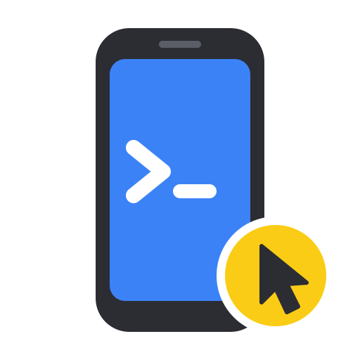

<a name="readme-top"></a>

<div align="right">
  <a href="README.md">English</a> | <b>简体中文</b>
</div>

<div align="center">
  <a href="https://github.com/Derrors/iphone-control-toolkit">
    
  </a>

  <h3 align="center">iphone-control-toolkit</h3>

  <p align="center">
    让 AI 助手操作一台插在 Linux 机器上的真实 iPhone：不需要 Mac，不需要付费开发者账号，不越狱。
  </p>

  <p align="center">
    <a href="https://github.com/Derrors/iphone-control-toolkit/releases/latest"></a>
    <a href="https://github.com/Derrors/iphone-control-toolkit/pkgs/container/iphone-control-toolkit"></a>
    
    
    <a href="https://github.com/Derrors/iphone-control-toolkit/actions/workflows/ci.yml"></a>
    <a href="LICENSE"></a>
  </p>

  <p align="center">
    <a href="#快速开始"><strong>🚀 快速开始</strong></a>
    &nbsp;·&nbsp;
    <a href="#文档"><strong>📖 文档</strong></a>
    &nbsp;·&nbsp;
    <a href="https://github.com/Derrors/iphone-control-toolkit/releases">📦 版本发布</a>
    &nbsp;·&nbsp;
    <a href="https://github.com/Derrors/iphone-control-toolkit/issues">🐛 问题反馈</a>
  </p>
</div>

> [!IMPORTANT]
> **推荐改用 [iphone-control](https://github.com/Derrors/iphone-control) 替代本项目。** 它是 iphone-control-toolkit 的后继项目：用一个 Rust 程序取代容器里的多个组件，支持 Linux 和 macOS，支持 iPhone 和 iPad，并且保持 MCP 工具兼容，现有的提示词和客户端可以照常使用。

> [!NOTE]
> 早期版本，目前在 **iPhone 15 Pro Max（iOS 27.0.1）** 和 x86_64 Debian 宿主机上测试过。其他机型、iOS 17～26、arm64 宿主机还没有测试，欢迎反馈。

## 简介

AI 助手已经能操作浏览器和桌面，但真实 iPhone 难得多：苹果的自动化工具必须用 Mac 和 Xcode，开源方案又是零散的几个工具，每个都要单独安装、签名、看护。

iphone-control-toolkit 把它们装进 Linux 上的**一个 Docker 容器**：从锁定的源码构建 [go-ios](https://github.com/danielpaulus/go-ios)、[pymobiledevice3](https://github.com/doronz88/pymobiledevice3)、[plumesign](https://github.com/claration/impactor) 和 [WebDriverAgent](https://github.com/appium/WebDriverAgent)，负责让它们持续运行，再通过 MCP 把手机交给 Claude Code 或任意 MCP 客户端。

```
Claude Code / 任意 MCP 客户端
        │  MCP，stdio（经 docker exec）
        ▼
┌──────────── Linux 上的 Docker 容器 ─────────────┐
│  MCP 服务 ─┬─ WebDriverAgent      （主路线）     │
│            └─ CoreDevice HID      （后备）       │
│  守护进程：断线重连 · 自动重启 · 自动重签 · 告警 │
└──────────────────────┬──────────────────────────┘
                       │ USB
                    iPhone
```

## 功能特性

- **看屏幕、点屏幕**：截图（可放大局部）、点击、滑动、长按、输入文字（支持中文）、硬件按键
- **按控件操作**：读取界面元素树，按名字点按钮；启动、结束 App，打开链接
- **自动后备**：WebDriverAgent 不可用时，截图、点击、滑动、按键自动改走苹果的 CoreDevice HID 服务（iOS 27+，免签名）
- **无人值守**：USB 重插、手机重启、隧道断开、WebDriverAgent 崩溃后都能自动恢复；免费 Apple ID 的描述文件 7 天到期前自动重签
- **通知**：重签失败、手机离线、重启后需要输入密码时，推送 Telegram 或 Bark
- **可选自动解锁**：手机可以正常锁屏；每一位密码都会核对，密码配置错误时输错一次就停用自动解锁
- **实时画面**：`iphonectl viewer` 在桌面上打开一个窗口，实时显示手机屏幕（USB 下最高约 25 fps），可以用鼠标和键盘操作，AI 照常工作
- **可选的 WebView 调试**：通过 Chrome DevTools Protocol 开放 Safari 标签页和可检查的 WebView（Capacitor、Cordova、你自己的 `WKWebView`），工具可以直接读 DOM 和控制台，不用靠截图
- **诊断**：`iphonectl doctor` 从 USB 到 WebDriverAgent 逐层检查，每项失败都给出修复办法

## 快速开始

需要：装有 Docker（Compose v2.24+）的 Linux 宿主机、iOS 17+ 的 iPhone 和一根**能传数据**的 USB 线，以及一个免费 Apple ID（建议专门注册一个，不要用主账号）。

```bash
git clone https://github.com/Derrors/iphone-control-toolkit.git
cd iphone-control-toolkit
bin/iphonectl setup          # 引导式安装，可重复运行
bin/iphonectl mcp install    # 注册到 Claude Code
```

`setup` 会拉取 `ghcr.io/derrors/iphone-control-toolkit` 镜像，然后引导你完成配对、开发者模式、挂载开发者镜像、登录 Apple ID、签名并安装 WebDriverAgent。已经完成的步骤会自动跳过。

新开一个 Claude Code 会话，比如这样说：

> 打开「时钟」，切到秒表页，截图给我看。

> [!TIP]
> 其他 MCP 客户端：服务通过 `docker exec` 走 stdio，不开放任何网络端口。
>
> ```json
> { "mcpServers": { "iphone": { "command": "docker", "args": ["exec", "-i", "iphone-control-toolkit", "/opt/ictl/mcp-server.sh"] } } }
> ```

想从源码构建镜像、不拉取发布的镜像，在 `.env` 里设置 `IMAGE=iphone-control-toolkit:local`。

## MCP 工具

| 工具 | 说明 |
| --- | --- |
| `iphone_status` | 连接状态、是否锁屏、前台 App、屏幕尺寸 |
| `iphone_screenshot` | 截图，已缩放到点坐标；传 `x/y/width/height` 放大局部 |
| `iphone_list_elements` | 带文字的界面元素及其中心坐标 |
| `iphone_tap` / `iphone_tap_element` | 按坐标或按名字点击 |
| `iphone_swipe` / `iphone_long_press` | 滑动、长按 |
| `iphone_type_text` | 在当前输入框里输入文字 |
| `iphone_press_button` | `home`、`volume_up`、`volume_down`、`lock` |
| `iphone_list_apps` / `iphone_launch_app` / `iphone_terminate_app` | 按名字或 Bundle ID 管理 App |
| `iphone_open_url` | 打开链接或 URL Scheme |

截图的像素坐标就是点击坐标，AI 看到哪里就能点哪里。游戏、地图、视频播放器自己绘制界面，没有元素树，只能看截图按坐标操作。

## 实时画面

```bash
bin/iphonectl viewer
```

在宿主机上打开一个窗口，实时显示手机屏幕（来自 WebDriverAgent 的 MJPEG 流），并把你的操作转发给手机。它和 MCP 服务同时运行、共用同一个 WebDriverAgent 会话，你可以看着 AI 操作，也可以随时接手。

| 操作 | 手机上的效果 |
| --- | --- |
| 单击 / 按住 | 点击 / 长按 |
| 拖动、滚轮 | 滑动、滚动 |
| 键盘 | 在当前输入框里输入 |
| Esc、右键、**⌂ Home** | Home 键 |
| **✕ Close app** | 结束前台 App，相当于在多任务界面里把它划掉 |

iOS 会忽略不是手指发出的系统手势，比如从屏幕底部上滑，所以窗口提供了对应的按钮。窗口大小可以随意调整。帧率、分辨率等选项见 `iphonectl viewer --help`。

宿主机需要 Python 3.11+，以及 Tk 和 Pillow：`sudo apt install python3-tk python3-pil.imagetk`（Debian/Ubuntu）或 `sudo pacman -S tk python-pillow`（Arch）。

手机接在没有图形界面的主机（比如 NAS）上时，在桌面电脑上克隆本仓库后运行：

```bash
ssh -N -L 8100:127.0.0.1:8100 -L 9100:127.0.0.1:9100 你的主机 &
PYTHONPATH=src python3 -m iphone_viewer
```

## 调试 WebView

默认关闭。在 `.env` 里设置 `CDP_PORT=9222` 后运行 `iphonectl up`，容器就会在 `127.0.0.1:9222` 上通过 [Chrome DevTools Protocol](https://chromedevtools.github.io/devtools-protocol/) 开放手机的 Safari 标签页和可检查的 WebView：`curl 127.0.0.1:9222/json` 列出它们，任何支持 CDP 的工具都可以连上去读 DOM、执行 JavaScript、查看控制台输出和网络请求。对混合开发的 App 来说，这比元素树和截图更快也更准。

> [!WARNING]
> 开启期间，宿主机上的任何进程都能读取和操作手机的 Safari 标签页，包括你已登录的网站。桥接没有认证，也不检查请求来源，请只在需要时开启，并且只在你信任的主机上开启。

1. 在手机上打开 **设置 → App → Safari 浏览器 → 高级 → 网页检查器**。
2. App 里的 `WKWebView` 必须可检查（`isInspectable = true`，iOS 16.4+）。Safari 始终可检查。

> [!TIP]
> **不用 Xcode 构建的 Capacitor App**（比如用 [xtool](https://github.com/xtool-org/xtool)）：Capacitor 只在调试构建里让 WebView 可检查，而它是通过 Info.plist 里的 `CAPACITOR_DEBUG` 判断调试构建的，这个键只有 Xcode 的构建设置会填。请在 `capacitor.config.ts` 里显式设置，并且只用于开发构建：
>
> ```ts
> ios: { webContentsDebuggingEnabled: !isReleaseBuild },
> ```

`iphonectl doctor` 会报告有几个可检查的页面。CDP 桥接和实时画面都只监听 `127.0.0.1`，和 WebDriverAgent 一样没有认证；不需要实时画面时，在 `.env` 里设置 `MJPEG_PORT=0` 关闭。要从其他机器访问，请用 SSH 端口转发，不要把它们绑到其他网卡上。

## 常用命令

| 命令 | 作用 |
| --- | --- |
| `iphonectl status` | 容器状态和最近的守护日志 |
| `iphonectl doctor` | 逐层诊断，每项失败都给出修复办法 |
| `iphonectl viewer` | 实时查看屏幕，用鼠标和键盘操作 |
| `iphonectl logs [名字] [-f]` | 看日志：`supervisor`、`wda`、`tunnel`、`resign`、`notify` 等 |
| `iphonectl resign [--force]` | 快过期时重签 WebDriverAgent；`--force` 立即重签 |
| `iphonectl login` | Apple ID 登录过期时重新登录 |
| `iphonectl passcode set\|clear` | 开启或关闭自动解锁 |
| `iphonectl pull && iphonectl up` | 升级到最新镜像 |

配置在 `.env` 里（由 `.env.example` 生成）：代理、Telegram / Bark、数据目录归属用户。所有状态都在 `data/` 里：配对记录、Apple ID 登录状态和签名私钥、证书、锁屏密码。**请备份，不要提交，不要分享。**

## 文档

| | |
| --- | --- |
| 设计 | [架构](docs/architecture.md)：组件、两条控制路线、守护和重签流程 |
| 运维 | [故障排查](docs/troubleshooting.md) · [安全](docs/security.md) |
| 开发 | [开发指南](docs/development.md)：测试、升级锁定的上游版本 |
| 许可证 | [THIRD_PARTY.md](THIRD_PARTY.md)：内含组件、版本和许可证 |

## 限制

- 一台宿主机只控制一部手机，不要让两个实例同时连同一部手机
- 免费 Apple ID 的描述文件 7 天过期。重签是自动的，但 Apple ID 登录过期后要运行 `iphonectl login`
- 手机重启后，要在手机上输一次锁屏密码才能启用 UI 自动化，这是 iOS 的要求
- 可见性按坐标判断，被弹窗挡住的元素也可能被列出来
- 系统手势（底部上滑、控制中心、通知中心）无法从外部注入；请改用 Home 键、按 Bundle ID 结束 App 和 URL Scheme

> [!WARNING]
> 这个工具能完全控制你的手机。AI 可能点到付款、删除、发送等按钮，请在 MCP 客户端里保持工具调用确认。本项目与 Apple 无关，请只用于你自己的设备。

## 参与贡献

欢迎通过 [Issues](https://github.com/Derrors/iphone-control-toolkit/issues) 反馈问题或提出建议，请附上 `iphonectl doctor` 的输出（先去掉 UDID）。也欢迎提交 Pull Request，见[开发指南](docs/development.md)。

## 许可证

本项目代码采用 [MIT](LICENSE) 许可证。容器镜像还包含其他许可证（包括 GPL-3.0）的上游组件，每个版本发布都会附上它们的完整对应源码，见 [THIRD_PARTY.md](THIRD_PARTY.md)。

<p align="right">(<a href="#readme-top">回到顶部</a>)</p>
